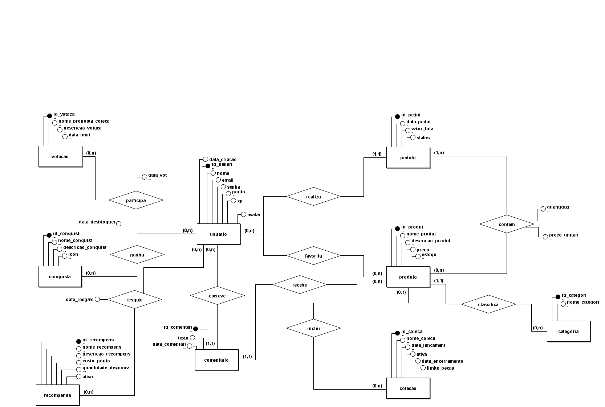

# DripLab

Plataforma web de streetwear digital-first, com catálogo de produtos, drops e recursos de interação com a comunidade.

## Links

- **Site integrado na Vercel** — [Abrir DripLab](https://driplab-lovat.vercel.app/)
- **Repositório GitHub:** [https://github.com/Chario-Sousa/driplab](https://github.com/Chario-Sousa/driplab)
- **Documentação da API** — [Especificação OpenAPI](docs/api.json)
- **Protótipo estático** — [GitHub Pages](https://chario-sousa.github.io/driplab/)

O site da Vercel usa a API Express, o PostgreSQL e a autenticação do Supabase. O GitHub Pages hospeda o protótipo estático com dados demonstrativos.

## Objetivo do sistema

A DripLab é uma plataforma de streetwear criada para apresentar produtos e coleções de uma marca digital-first. A proposta combina a experiência de catálogo de uma loja virtual com telas para comunidade e interação.

## Funcionalidades

- Catálogo com busca por nome ou categoria, filtros, detalhes e favoritos por conta.
- Cadastro, login por e-mail e perfil via Supabase Auth.
- Carrinho, registro de pedidos com baixa de estoque e histórico no perfil.
- Drops com datas, contagem regressiva e limite compartilhado de unidades.
- Painel administrativo para cadastrar e editar coleções, enviar capas e vincular produtos.
- Cadastro, edição, desativação e exclusão de produtos pelo painel administrativo, com histórico de pedidos preservado.
- Votação da comunidade com um voto por conta, capas, contagem pública e encerramento pelo painel.
- Histórico de votações no painel, com ações para ocultar, voltar a exibir resultados e excluir definitivamente.
- Comentários por votação, drop e produto, com foto de perfil pública e edição ou exclusão pelo autor.
- Gamificação no perfil com pontos, níveis, conquistas e recompensas de títulos e descontos.

### Limitações atuais

- O checkout simula a compra e confirma novos pedidos automaticamente. A integração com pagamentos fica para uma etapa futura.

## Tecnologias utilizadas

- HTML5
- CSS3
- JavaScript
- Node.js
- Express
- Sequelize e PostgreSQL no Supabase
- MySQL e `mysql2` para execução local com o banco original
- Git e GitHub
- Vercel para publicação da versão integrada
- GitHub Pages para publicação da demonstração estática

## Banco de dados e modelagem

O catálogo no Supabase usa as tabelas `categoria`, `colecao` e `produto`. As tabelas `pedido` e `item_pedido` registram os pedidos vinculados ao Supabase Auth e preservam o preço de cada item. A função `criar_pedido` usa o estoque e os preços do banco ao registrar o pedido. O modelo completo do banco original MySQL `driplab_db` contém 14 tabelas:

`usuario`, `colecao`, `categoria`, `conquista`, `votacao`, `recompensa`, `produto`, `pedido`, `comentario`, `favorita`, `ganha`, `contem`, `participa` e `resgate`.

### Scripts SQL

- [Migração do catálogo para PostgreSQL e dados de exemplo](sql/catalogo_postgres.sql)
- [Migração de pedidos e baixa de estoque](sql/pedidos_postgres.sql)
- [Migração de favoritos por conta](sql/favoritos_postgres.sql)
- [Migração dos períodos e limites de drops](sql/drops_postgres.sql)
- [Migração do painel administrativo de coleções](sql/admin_colecoes_postgres.sql)
- [Migração de votações da comunidade](sql/votacoes_postgres.sql)
- [Migração das capas das opções de votação](sql/capas_votacoes_postgres.sql)
- [Migração dos comentários da Comunidade](sql/comentarios_postgres.sql)
- [Migração da gamificação](sql/gamificacao_postgres.sql)
- [Migração das fotos de perfil, comentários por produto e imagens de detalhe](sql/refinamento_postgres.sql)
- [Migração da visibilidade de votações](sql/visibilidade_votacoes_postgres.sql)
- [Migração da gestão de produtos e do histórico de pedidos](sql/gestao_produtos_postgres.sql)
- [Criação do banco original no MySQL](sql/criar_banco.sql)
- [Inserção dos dados de teste no MySQL](sql/inserir_dados.sql)

### Modelagem

- [Modelo conceitual — arquivo do brModelo](docs/dripconceito.xml)
- [Modelo lógico — arquivo do brModelo](docs/driplogico.xml)
- Diagrama Entidade-Relacionamento (DER):



## Execução com Supabase

1. Clone o repositório, abra a pasta `driplab` e instale as dependências com `npm ci`. Use **Node.js 22 ou superior**.
2. Em um projeto Supabase novo, aplique `sql/catalogo_postgres.sql`, `sql/pedidos_postgres.sql`, `sql/drops_postgres.sql`, `sql/favoritos_postgres.sql`, `sql/admin_colecoes_postgres.sql`, `sql/votacoes_postgres.sql`, `sql/capas_votacoes_postgres.sql`, `sql/comentarios_postgres.sql` e `sql/gamificacao_postgres.sql`, nessa ordem.
3. No Supabase, abra **Connect** e copie a URI do **Transaction pooler**. Preencha a senha do banco na URI e use codificação de URL para caracteres especiais da senha.
4. Adicione `DATABASE_URL` ao arquivo local `.env` com a URI preenchida. Mantenha esse arquivo fora do Git.
5. Em `public/auth-config.json`, configure `url` com a URL do mesmo projeto Supabase e `chavePublica` com a chave publicável desse projeto. Esse arquivo é servido ao navegador e deve conter apenas a configuração pública.
6. Execute `sql/fotos_catalogo.sql` para carregar as miniaturas do catálogo e, em seguida, aplique `sql/refinamento_postgres.sql`, `sql/visibilidade_votacoes_postgres.sql` e `sql/gestao_produtos_postgres.sql`.
7. Rode `npm start` e confira [a conexão](http://localhost:3000/api/health) e [os produtos](http://localhost:3000/api/produtos). Depois, abra [o site local](http://localhost:3000/).

Para publicar na Vercel, importe o repositório como um projeto Express e configure `DATABASE_URL` como variável privada no ambiente usado pelo deploy. Teste `/api/health` e `/api/produtos` no endereço publicado antes de validar o catálogo no navegador.

### Cadastro e login

O `npm ci` prepara o SDK do Supabase para as páginas de autenticação. O login usa o e-mail e a senha da conta. O nome de exibição aparece no perfil.

Para abrir o painel em um projeto novo, cadastre e confirme a conta da equipe. No SQL Editor do Supabase, vincule só essa conta a `public.administrador`, usando o e-mail dela no lugar do exemplo.

```sql
insert into public.administrador (id_usuario)
select id
from auth.users
where lower(email) = lower('equipe@exemplo.com')
  and email_confirmed_at is not null
  and not is_anonymous
on conflict do nothing;
```

Em **Authentication → URL Configuration** no Supabase, configure o endereço principal do site como **Site URL** e adicione o endereço completo de `perfil.html` à lista **Redirect URLs**. Para testar no navegador local, adicione também `http://localhost:3000/perfil.html`.

Com a confirmação de e-mail ativada, use um endereço da equipe para testar com o serviço de e-mail padrão do Supabase. Configure [SMTP próprio](https://supabase.com/docs/guides/auth/auth-smtp) para enviar confirmações a clientes de fora da equipe.

### Pedidos

Abra o catálogo, adicione um produto, entre na sua conta e clique em **Finalizar compra**. O pedido de demonstração é confirmado e aparece em **Meus pedidos**. Estoque, preços e identidade do cliente são conferidos pelo servidor.

Na confirmação, a conta do cliente recebe 50 pontos e 50 XP. A primeira confirmação também libera o título **Estreante DripLab**. Uma conta administrativa pode abrir **Perfil → Administração → Gerenciar pedidos** para confirmar pedidos anteriores que ainda estejam pendentes.

`POST /api/pedidos` recebe `chave_solicitacao` (UUID) e `itens` com `id_produto` e `quantidade`. Reenvie a mesma chave ao repetir a tentativa com os mesmos itens. `GET /api/pedidos` retorna o histórico do usuário autenticado. As duas rotas exigem o token de acesso do Supabase Auth no cabeçalho `Authorization: Bearer`.

### Drops

`GET /api/drops` retorna as datas e as peças restantes de cada drop anunciado. A página inicial usa esses dados para mostrar quando abre ou encerra a venda.

Defina o início, o encerramento opcional e o limite total de unidades em **Perfil → Administração → Gerenciar coleções**. O painel usa o horário de Brasília. Pedidos pendentes e confirmados ocupam o limite compartilhado da coleção.

### Gamificação

Votar em uma enquete rende 20 pontos e 20 XP. O primeiro comentário rende 10 pontos e 10 XP. Cada pedido confirmado rende 50 pontos e 50 XP. A migração aproveita as ações já registradas.

O XP acumulado necessário para subir de nível é `75 × nível atual^1,2`, arredondado ao inteiro mais próximo. São 75 XP para chegar ao nível 2, 172 XP para o nível 3 e 280 XP para o nível 4. Cada resgate reduz o saldo de pontos. O XP acumulado determina o nível.

Em **Perfil → Recompensas**, troque 30 pontos por 5% de desconto ou 50 pontos por 10% de desconto. Após usar um desconto, você pode resgatá-lo novamente pelo mesmo custo. A conta pode manter um desconto disponível de cada percentual e aplicar um por pedido.

Em **Perfil → Títulos**, resgate títulos com pontos ou desbloqueie títulos ao completar uma conquista. O primeiro voto libera **Voz da Enquete**, o primeiro comentário libera **Voz do Drop** e a primeira compra confirmada libera **Estreante DripLab**. Os títulos de conquistas são liberados automaticamente.

Use **Usar título** para exibi-lo no perfil. A troca e a remoção preservam os títulos disponíveis e o saldo de pontos. O atalho abaixo do nome abre a aba de títulos.

Em **Perfil → Administração → Gerenciar coleções**, o administrador pode definir o nível mínimo para comprar em cada drop. Os produtos ficam visíveis no catálogo, e o sistema confere o nível ao registrar o pedido.

## Execução local com o MySQL original

### Requisitos

- Node.js 22 ou superior e npm
- MySQL Server
- MySQL Workbench, recomendado para executar os scripts SQL

### 1. Clonar o repositório

```bash
git clone https://github.com/Chario-Sousa/driplab.git
cd driplab
```

### 2. Instalar as dependências

```bash
npm install
```

### 3. Criar e popular o banco

No MySQL Workbench, execute os scripts nesta ordem, em um banco vazio:

1. `sql/criar_banco.sql`
2. `sql/inserir_dados.sql`

Execute o script de inserção apenas uma vez para evitar registros duplicados.

### 4. Configurar a conexão local

Crie um arquivo `.env` na raiz do projeto, no mesmo nível de `package.json`:

```env
DB_HOST=127.0.0.1
DB_PORT=3306
DB_NAME=driplab_db
DB_USER=seu_usuario_mysql
DB_PASSWORD=sua_senha_mysql
PORT=3000
```

Substitua `seu_usuario_mysql` e `sua_senha_mysql` pelos dados da sua instalação local do MySQL. O Express usa as variáveis `DB_*` para MySQL quando `DATABASE_URL` está ausente na execução local.

**Não envie o arquivo `.env` ao GitHub.** Ele contém credenciais; o `.gitignore` do projeto deve mantê-lo fora do repositório.

### 5. Iniciar o servidor

Com o MySQL em execução, inicie o servidor:

```bash
npm start
```

Acesse no navegador:

- Site local: [http://localhost:3000/](http://localhost:3000/)
- Verificar API e conexão com o banco: [http://localhost:3000/api/health](http://localhost:3000/api/health)
- Consultar produtos no MySQL: [http://localhost:3000/api/produtos](http://localhost:3000/api/produtos)

## Estrutura principal do projeto

- `public/` — arquivos do site usados pelo servidor local.
- `src/` — servidor Express e configuração de conexão com o banco.
- `sql/` — scripts de criação do banco e de inserção de dados.
- `docs/` — modelos do banco e arquivos estáticos publicados pelo GitHub Pages.
- `package.json` — dependências e comandos do projeto.

## Roteiro de demonstração

1. Abra o [site na Vercel](https://driplab-lovat.vercel.app/) e mostre o catálogo e a busca.
2. Abra [Coleções](https://driplab-lovat.vercel.app/colecoes.html), selecione um drop e mostre a Shop filtrada.
3. Entre na sua conta, abra **Perfil → Meus pedidos** e mostre um pedido de teste já registrado. Mostre também os favoritos salvos no perfil.
4. Abra **Comunidade** pelo menu principal e mostre a enquete, a contagem, o voto registrado e os comentários da votação. Na Shop filtrada por coleção, mostre os comentários daquele drop.
5. Na conta administrativa, abra **Perfil → Administração** para mostrar os painéis de produtos, coleções, votações e pedidos. Para verificar a integração com o banco, abra [a rota de saúde](https://driplab-lovat.vercel.app/api/health).
